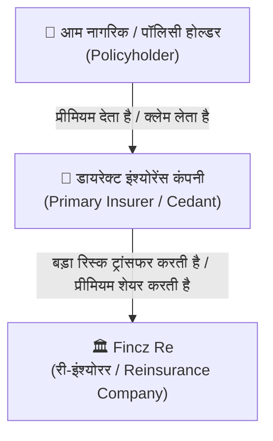
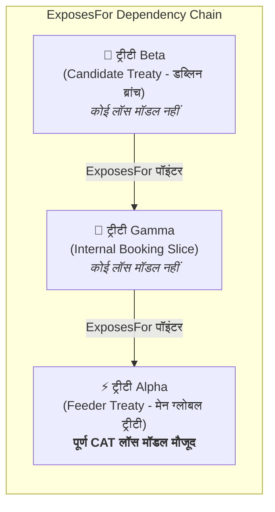
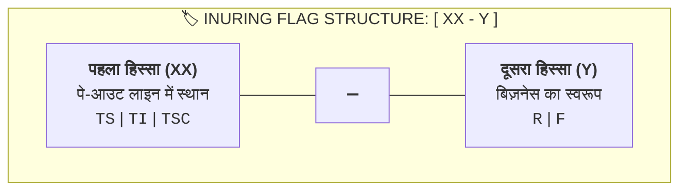
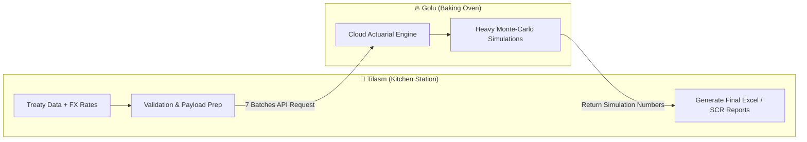

> [!NOTE] 
> **री-इंश्योरेंस (Reinsurance)** बिज़नेस डोमेन, **Fincz Re** के इंटरनल रिस्क मॉडलिंग प्लेटफॉर्म **Tilasm** और क्लाउड कैलकुलेशन इंजन **Golu** का पूरा बिज़नेस और टेक्निकल फ्लो।

---

## 1. री-इंश्योरेंस क्या है? (एकदम बेसिक और आसान भाषा में)

### 💡 रियल-लाइफ मिसाल (दुकानदार और होलसेलर का एनालॉजी)
मान लीजिए आपके शहर में एक छोटा दुकानदार है। वह आम लोगों को सामान बेचता है। अगर कभी अचानक शहर में बहुत भारी आपदा या बाढ़ आ जाए और उसका सारा माल तबाह हो जाए, तो वह अकेले भरपाई नहीं कर पाएगा। इसलिए वह एक बड़े राज्य-स्तरीय डिस्ट्रीब्यूटर या होलसेलर से बैकअप का समझौता रखता है।

यही काम **Reinsurance (री-इंश्योरेंस)** का है:
> [!TIP]
> **सादा अल्फ़ाज़ में:** जैसे आम इंसान अपनी सुरक्षा के लिए इंश्योरेंस कंपनी के पास जाता है, वैसे ही **इंश्योरेंस कंपनियां अपने भारी नुकसान के खतरे से बचने के लिए Reinsurance कंपनी (जैसे Fincz Re) के पास जाती हैं।**  
> इसे आसान बोलचाल में **"इंश्योरेंस का इंश्योरेंस"** कहा जाता है।

---

## 2. हेल्थ इंश्योरेंस vs री-इंश्योरेंस (सीधा तुलनात्मक फर्क)

चूंकि आपने पहले **Health Insurance** डोमेन में काम किया है, इसलिए दोनों डोमेन के अंतर को समझना आपके लिए सबसे आसान रास्ता है:

| पहलू (Aspect) | 🏥 हेल्थ इंश्योरेंस (Primary Insurance) | 🏛️ री-इंश्योरेंस (Reinsurance - Fincz Re) |
| :--- | :--- | :--- |
| **ग्राहक (Customer)** | एक आम इंसान (B2C) | दूसरी इंश्योरेंस कंपनी (B2B) |
| **कॉन्ट्रैक्ट का रूप** | इंडिविजुअल पॉलिसी (1 साल की हेल्थ पॉलिसी) | ट्रीटी (Treaty) या फैकल्टेटिव (FAC) एग्रीमेंट |
| **क्लेम का दायरा** | एक मरीज़ का अस्पताल का बिल (हज़ारों/लाखों में) | एक साथ हज़ारों लोगों या सैकड़ों फैक्ट्रियों का महा-नुकसान (करोड़ों-अरबों में) |
| **रिस्क का प्रकार** | बीमारी, एक्सीडेंट, सर्जरी, मैटरनिटी | तूफ़ान (Cyclone), भूकंप (Earthquake), सुनामी, महामारियां |
| **डेटा का रूप** | पेशेंट नाम, क्लेम फॉर्म, डायग्नोसिस कोड (ICD/CPT) | पोर्टफोलियो डेटा, लॉस मॉडल कैटलॉग, री-इंश्योरेंस लेयर्स |
| **कोर फोकस** | क्लेम एडजुडिकेशन (Claim Adjudication) और फ्रॉड डिटेक्शन | कैपिटल मैनेजमेंट, सॉल्वेंसी (SCR) और रिस्क सिमुलेशन |

---

## 3. ज़रूरी अल्फ़ाज़ और मतलब (Domain Glossary)

री-इंश्योरेंस और इस प्रोजेक्ट में बार-बार आने वाले भारी-भरकम शब्दों का आसान मतलब:

| टर्म (Term) | आसान भाषा में मतलब (Meaning) | रियल-लाइफ मिसाल (Example) |
| :--- | :--- | :--- |
| **Fincz Re** | वह री-इंश्योरेंस कंपनी जो दूसरी कंपनियों से रिस्क अपने ऊपर लेती है। | मान लीजिए HDFC Ergo ने कई घरों का बीमा किया है, और उसने अपने रिस्क का हिस्सा Fincz Re को दिया। |
| **Cedant (सीडिंग कंपनी)** | वह ओरिजिनल इंश्योरेंस कंपनी जो अपना रिस्क री-इंश्योरर को ट्रांसफर कर रही है। | ऊपर वाले उदाहरण में HDFC Ergo 'Cedant' कहलाएगी। |
| **Treaty (ट्रीटी)** | री-इंश्योरेंस का मुख्य कानूनी कॉन्ट्रैक्ट/एग्रीमेंट। इसमें नियम तय होते हैं कि कितना प्रीमियम मिलेगा और कब कितना क्लेम दिया जाएगा। | एक साल का फॉर्मल कॉन्ट्रैक्ट कि चेन्नई के सारे तूफ़ान क्लेम्स का 30% हिस्सा Fincz Re भरेगी। |
| **CAT (Catastrophe Risk)** | कुदरती आफत या बहुत बड़े हादसों से होने वाला महा-नुकसान। | भूकंप (Earthquake), तूफ़ान (Windstorm), बाढ़ (Flood)। |
| **Non-CAT Risk** | रोज़मर्रा या सामान्य बड़े व्यक्तिगत नुकसान जो किसी प्राकृतिक आपदा से जुड़े नहीं होते (Attritional / Large Loss)। | किसी एक बड़ी केमिकल फैक्ट्री में शॉर्ट-सर्किट से लगी आग। |
| **SCR (Solvency Capital Requirement)** | सरकारी/रेगुलेटरी नियमों के मुताबिक कंपनी को अपनी तिजोरी में कम से कम कितना कैश/कैपिटल रिज़र्व रखना अनिवार्य है ताकि 200 साल में एक बार आने वाली भयंकर आफत में भी कंपनी दिवालिया न हो। | जैसे बैंक में मिनिमम रिज़र्व बैलेंस रखना पड़ता है, वैसे ही री-इंश्योरर के लिए रिस्क के हिसाब से तय फंड। |
| **1-in-200 Year Event** | ऐसा भयंकर हादसा जिसके होने की सालाना संभावना 0.5% होती है (सांख्यिकीय जोखिम पैमाना)। | 2004 की सुनामी जैसा ऐतिहासिक नुकसान। |
| **Golu** | एक्सटर्नल क्लाउड-बेस्ड एक्चुएरियल (Actuarial) कैलकुलेशन सर्विस/इंजन। | जो लाखों जटिल सिमुलेशंस और स्टैटिस्टिकल मैथ्स कैलकुलेट करता है। |
| **Tilasm** | Fincz Re का इंटरनल रिस्क मॉडलिंग और कैपिटल रिपोर्टिंग सिस्टम। | जो सारा डेटा इकट्ठा करता है, Golu को काम सौंपता है और फाइनल रिपोर्ट बनाता है। |

---

## 4. SCR (Solvency Capital Requirement) क्या है? (गहराई से समझें)

### 📌 आसान रियल-लाइफ मिसाल: परिवार का इमरजेंसी फंड और RBI का CRR
1. **घरेलू बजट की मिसाल:**  
   मान लीजिए आपके घर का मासिक खर्च ₹50,000 है। लेकिन आप अपने बैंक खाते में हमेशा ₹5 लाख का फिक्स्ड इमरजेंसी फंड रखते हैं। क्यों? ताकि अगर कभी परिवार में कोई बहुत बड़ा मेडिकल संकट या नौकरी छूटने जैसी अनहोनी आ जाए, तो परिवार सड़क पर न आ जाए और दिवालिया होने से बच जाए।
2. **बैंकिंग मिसाल (RBI CRR):**  
   जैसे रिज़र्व बैंक ऑफ इंडिया (RBI) हर बैंक को आदेश देता है कि वह अपनी कुल जमा-पूंजी का एक निश्चित हिस्सा (CRR - Cash Reserve Ratio) अपनी तिजोरी में कैश के रूप में रखे, ताकि बैंक कभी डूब न सके।

### ⚖️ यूरोपीय यूनियन के Solvency II नियम में SCR क्या है?
यूरोपीय यूनियन (EU) में इंश्योरेंस कंपनियों के लिए बेहद कड़े कानून हैं जिन्हें **Solvency II Framework** कहा जाता है।
इसके अनुसार:
> **Solvency Capital Requirement (SCR)** वह न्यूनतम रिज़र्व फंड (Capital) है जो Fincz Re को हर समय अपने पास लिक्विड/सुरक्षित रूप में रखना अनिवार्य है, ताकि यदि अगले 12 महीनों में **"200 साल में 1 बार आने वाली सबसे भयंकर महा-आपदा"** भी आ जाए, तो भी कंपनी 99.5% गारंटी के साथ अपने सारे क्लेम चुका सके और जिंदा रहे।

### 🔢 1-in-200 Year Event का गणितीय मतलब:
- इसका मतलब यह नहीं है कि ऐसी घटना ठीक 200 साल में एक ही बार घड़ी देखकर आएगी!
- इसका मतलब है कि **सालाना 0.5% संभावना (Annual Probability = 1/200 = 0.5%)** वाला सबसे खौफनाक प्राकृतिक हादसा (जैसे 2004 की सुनामी, 2011 का जापान भूकंप व फुकुशिमा, या 2005 का कैटरीना तूफान)।

### 🎯 Tilasm और Golu में SCR का रोल:
- Fincz Re के पास हज़ारों ट्रीटीज़ हैं।
- **Golu का काम:** इन हज़ारों ट्रीटीज़ पर लाखों नकली तूफ़ान, भूकंप और बाढ़ के सिनारियो चलाकर देखना कि सबसे खराब 0.5% स्थिति में Fincz Re को कुल कितना नुकसान झेलना पड़ सकता है।
- **Tilasm का काम:** उस आंकड़े को लेकर फाइनल SCR रिपोर्ट तैयार करना, जिसे सरकारी रेगुलेटर्स (जैसे BaFin/EIOPA) और ऑडिटर्स सीधे चेक करते हैं।
- **चेतावनी:** अगर Tilasm में डेटा की मैपिंग ज़रा भी गलत हुई, तो SCR का आंकड़ा गलत निकलेगा—जिससे कंपनी पर भारी कानूनी जुर्माना लग सकता है या लाइसेंस रद्द हो सकता है!

---

## 5. री-इंश्योरेंस खरीदने के 2 बुनियादी तरीके (Treaty vs Facultative)

कोड और डेटा मॉडल में आपको बार-बार **Treaty** और **Facultative (FAC)** शब्द दिखेंगे। इनका फर्क समझें:

### 1. Treaty Reinsurance (डिफ़ॉल्ट और ऑटोमैटिक)
- सीडेंट (Cedant) और Fincz Re एक बार पूरे साल के लिए एक पूरी कैटेगरी का समझौता कर लेते हैं।
- *उदाहरण:* "जर्मनी में $1M से कम के जितने भी होम-ओनर पॉलिसी बिकेंगी, वे सब ऑटोमैटिकली कवर होंगी।"
- 🚗 **एनालॉजी:** एक कंपनी अपनी पूरी कार फ्लीट के लिए एक पॉलिसी खरीदती है। साल भर में फ्लीट में जितनी भी नई कारें जुड़ेंगी, वे बिना अलग कागज़ी कार्रवाई के ऑटोमैटिकली कवर हो जाएंगी।

### 2. Facultative Reinsurance ("FAC" - वन-ऑफ / केस-टू-केस)
- यह बिल्कुल उल्टा है। इसमें हर एक खास बड़े रिस्क पर अलग से बातचीत होती है।
- सीडेंट के पास चॉइस (Faculty) होती है कि वह यह खास रिस्क ऑफर करे या न करे, और Fincz Re के पास चॉइस होती है कि वह इसे कुबूल करे या रिजेक्ट करे।
- 🏎️ **एनालॉजी:** ऊपर वाली फ्लीट के अलावा, कंपनी के पास एक बहुत ही महंगी विंटेज/एंटीक कार (या बुर्ज खलीफा जैसी इमारत) है। वह इंश्योरर से अलग से कहती है: *"क्या आप सिर्फ इस एंटीक कार को अलग शर्तों पर कवर करेंगे?"*

> [!NOTE]
> **💻 कोड में इसका क्या असर होता है?**  
> चूंकि फैकल्टेटिव रिस्क पूरे ग्रुप में फिट नहीं बैठता, इसलिए Tilasm के कोड में FAC रिस्क को अलग नाम दिया जाता है (जैसे: `WindstormEurope_FAC_1234`) और पाइपलाइन के 7 में से 2 फ्लो में इसके लिए अलग ब्रांच चलती है।

---

## 6. लेयर्स (Layers) और इन्यूरिंग (Inuring) का असली मतलब

जब बहुत बड़ा नुकसान होता है, तो सारा पैसा कोई एक कंपनी नहीं भरती। नुकसान को स्लाइस (टुकड़ों) में बांटा जाता है, जिन्हें **Layers** कहते हैं।

> [!TIP]
> **Inuring (इन्यूरिंग) का सीधा मतलब:**  
> *"नुकसान का भुगतान किस क्रम (Order) में होगा, और पिछली लेयर खत्म होने के बाद अगली लेयर का फायदा किसको मिलेगा।"*  
> (जब लेयर A का पैसा चुक जाता है, तो लेयर B लागू होती है—इसे कहते हैं कि लेयर B *inures* करती है)।

---

## 7. $50M के तूफ़ान का प्रैक्टिकल उदाहरण (Who Pays What? - स्टेप-बाय-स्टेप डीप डाइव)

### 🌊 रियल-लाइफ सिनारियो:
मान लीजिए यूरोप के उत्तरी तट पर **"तूफ़ान एंथनी" (Cyclone Anthony)** आता है।
- इससे कई बड़े बंदरगाहों, शिपिंग यार्ड और तटीय गोदामों को भारी नुकसान पहुँचता है।
- इन सभी संपत्तियों का इंश्योरेंस Fincz Re की एक ट्रीटी के तहत कवर था।
- कुल इंश्योर्ड नुकसान का बिल निकलकर आता है: **$50 Million ($50M यानी लगभग ₹415 करोड़)**।

अब देखते हैं कि यह $50M का नुकसान Fincz Re की बैलेंस शीट तक पहुँचने से पहले किन-किन परतों (Layers) से होकर गुजरता है:

### 📋 प्रत्येक स्टेज का विस्तृत विश्लेषण:

| स्टेज (Stage) | इस स्टेज पर क्या होता है? (Mechanics) | Fincz Re पर बचा जोखिम | सिस्टम का टर्म (Code Term) | डेटा पाइपलाइन फ्लो |
| :---: | :--- | :---: | :---: | :---: |
| **1. Gross** | नुकसान का पूरा, कच्चा आंकड़ा। इसमें मान लिया जाता है कि Fincz Re के पास कोई भी सुरक्षा कवर नहीं है। | **$50M** | `Gross` | **Flow 1** |
| **2. Net** | **थर्ड-पार्टी री-इंश्योरेंस की कटौती:** Fincz Re ने किसी अन्य ग्लोबल री-इंश्योरर (जैसे Swiss Re / Munich Re) से समझौता कर रखा था कि "$30M से ऊपर और $50M तक का जो भी $20M का स्लाइस होगा, वह आप भरेंगे।" इसलिए $20M कट गया। | **$30M** | `Net` | **Flow 2** |
| **3. Net Internal Treaty** | **इंटरनल ब्रांच एलोकेशन:** इस $30M में से $10M का बिज़नेस Fincz Re की म्यूनिख ब्रांच ने लिखा था और इंटरनल कॉन्ट्रैक्ट से ट्रांसफर किया था। कुल नुकसान $30M ही रहता है, लेकिन सिस्टम में यह रिकॉर्ड होता है कि कौन-सी लीगल एंटिटी पर कितना बोझ पड़ेगा। | **$30M** *(इंटरनल री-एलोकेशन)* | `Net Internal Treaty` | **Flow 3** |
| **4. Retro (Retrocession)** | **रेट्रोसेशन कवर की कटौती:** Fincz Re ने अपने हिस्से के नुकसान पर भी एक अलग री-इंश्योरर से "रेट्रो कवर" ले रखा था कि "$25M से अधिक का कोई भी नुकसान आप भरेंगे।" अतः ऊपर का $5M ($30M - $25M) रेट्रो वाले ने भर दिया। | **$25M** | `Retro` | **Flow 5** |

> [!IMPORTANT]
> **अंतिम नतीजा:** $50M के महा-तूफ़ान के बावजूद, स्मार्ट लेयरिंग और इन्यूरिंग की वजह से Fincz Re की अंतिम देनदारी सिर्फ **$25M** रह गई!  
> Tilasm के बैकएंड में फ्लो 1, 2, 3 और 5 बिल्कुल इसी क्रमिक क्रम (`Gross` → `Net` → `Net Internal` → `Retro`) में कैलकुलेट होते हैं।

---

## 8. कैंडिडेट ट्रीटीज़ और फीडर्स (Candidate Treaties & Feeders - रियल लाइफ मिसाल)

### 🤔 बिज़नेस समस्या:
जब Golu को रिस्क सिमुलेशन चलाना होता है, तो उसे हर ट्रीटी के लिए एक **"लॉस मॉडल" (Loss Model)** चाहिए होता है (जिसमें लिखा होता है कि इस इलाके में तूफ़ान आने पर कितना नुकसान होगा)।
लेकिन कई ट्रीटीज़ सिर्फ कागज़ी या इंटरनल एकाउंटिंग ट्रीटीज़ होती हैं जिनका अपना कोई अलग लॉस मॉडल नहीं बना होता।
- *क्या हम इन ट्रीटीज़ को कैलकुलेशन से छोड़ सकते हैं?*  
  **बिल्कुल नहीं!** Solvency II के नियमों के तहत हर एक्टिव ट्रीटी को मॉडल में शामिल करना अनिवार्य है।

### 💡 रियल-लाइफ मिसाल: बिजली का एक्सटेंशन बोर्ड
- आपके घर के मुख्य कमरे में दीवार पर **मेन पावर सॉकेट (Main Power Socket)** है, जिसमें सीधे ग्रिड से बिजली (करंट) आ रही है।
- दूसरे कमरे में कोई मेन सॉकेट नहीं है, इसलिए आप वहां एक **एक्सटेंशन बोर्ड (Extension Board - Alpha)** लगाते हैं।
- अब तीसरे छोटे कोने में टेबल लैंप जलाने के लिए आप एक और छोटा **मल्टी-प्लग (Multi-plug - Beta)** उस एक्सटेंशन बोर्ड में लगा देते हैं।
- **मल्टी-प्लग Beta** का अपना कोई अलग पावर प्लांट नहीं है, वह करंट के लिए **एक्सटेंशन Board Alpha** पर निर्भर है, जो खुद मेन ग्रिड से जुड़ा है!

### 💻 Tilasm के कोड में यह कैसे काम करता है?
1. **Candidate Treaty (कैंडिडेट ट्रीटी):** वह ट्रीटी (जैसे `Beta`) जिसके पास अपना खुद का लॉस डेटा नहीं है और उसे फ़ॉलबैक (मदद) की ज़रूरत है।
2. **Feeder Treaty (फीडर ट्रीटी):** वह ट्रीटी (जैसे `Alpha`) जिसके पास असली डेटा है और वह दूसरों को डेटा "फ़ीड" (खिलाती) करती है।
3. **`ExposesFor` रिकॉर्ड:** Tilasm के डेटाबेस में एक खास टैग होता है। ट्रीटी Beta कहती है: `ExposesFor = Gamma` और Gamma कहती है `ExposesFor = Alpha`।
4. **कोड का काम (Flow 4 - Candidate Feed):** Tilasm का बैकएंड इस चेन को एक-एक कदम (hop by hop) वॉक करता है जब तक कि उसे असली लॉस मॉडल वाली फीडर ट्रीटी (Alpha) न मिल जाए। फिर Alpha के लॉस नंबर्स को Beta के लिए री-यूज़ कर लिया जाता है।

---

## 9. Inuring Flag क्या होता है? (कोड में इसका स्ट्रक्चर और केस स्टडीज़)

जब आप ट्रीटी डेटाबेस या कोड देखेंगे, तो आपको 2-हिस्सों वाला कोड दिखेगा, जैसे **`TI-F`**, **`TS-R`**, **`TSC-R`**।  
यह इन्यूरिंग फ्लैग (Inuring Flag) सिस्टम को दो बातें एक साथ बताता है:
1. **पे-आउट लाइन में यह ट्रीटी कहाँ खड़ी है?**
2. **यह ट्रीटी ऑटोमैटिक ग्रुप वाली है या वन-ऑफ (स्पेशल केस) वाली?**

| हिस्सा | कोड | पूरा नाम | आसान भाषा में मतलब (Plain Hindi) |
| :---: | :---: | :--- | :--- |
| **पहला भाग (XX)** *(Payout Position)* | `TS` | **Standalone** | **अकेली ट्रीटी:** यह किसी दूसरी ट्रीटी से नहीं जुड़ी है; इसका अपना स्वतंत्र क्लेम फ्लो है। |
| | `TI` | **Has Inuring Contracts** | **चेन में बंधी:** दूसरी ट्रीटीज़ का पे-आउट इस पर असर डालेगा या इसका भुगतान दूसरों को प्रभावित करेगा। |
| | `TSC` | **Has Sub-Contracts** | **सब-लेयर्स वाली:** इस मुख्य ट्रीटी के नीचे अपनी खुद की इंटरनल सब-लेयर्स (परतें) हैं। |
| **दूसरा भाग (Y)** *(Contract Type)* | `R` | **Treaty (Regular)** | **ऑटोमैटिक कवर:** पूरे बिज़नेस वर्ग (जैसे सभी कारें/घर) के लिए स्टैंडर्ड ब्लैंकेट पॉलिसी। |
| | `F` | **Facultative (FAC)** | **वन-ऑफ स्पेशल डील:** किसी एक खास भारी रिस्क के लिए अलग से की गई व्यक्तिगत डील। |

### 🏢 3 व्यावहारिक केस स्टडीज़ (Real-World Examples):

#### केस स्टडी 1: `TS-R` (Standalone Treaty)
- **मतलब:** `TS` (अकेली) + `R` (रेगुलर ट्रीटी)।
- **रियल-लाइफ मिसाल:** जर्मनी में सभी साधारण मोटर वाहनों (कार/बाइक) की स्टैंडर्ड एनुअल ट्रीटी। यह किसी दूसरी ट्रीटी से इंटरनली जुड़ी नहीं है। नुकसान होने पर सीधे इसकी अपनी शर्तों पर क्लेम प्रोसेस होगा।
- **सिस्टम का बर्ताव:** Tilasm इसे साधारण तरीके से प्रोसेस करके सीधे Golu को भेज देता है।

#### केस स्टडी 2: `TI-F` (Inuring Facultative)
- **मतलब:** `TI` (चेन में बंधी) + `F` (फैकल्टेटिव - स्पेशल रिस्क)।
- **रियल-लाइफ मिसाल:** रिलायंस रिफाइनरी या किसी विशाल केमिकल प्लांट का एक बड़ा स्पेशल वन-ऑफ इंश्योरेंस कवर। चूंकि इसका रिस्क बहुत विशाल है, इसलिए इसके भुगतान का क्रम दूसरी इंटरनल ट्रीटीज की लेयर्स के खत्म होने के बाद (Inure) शुरू होता है।
- **सिस्टम का बर्ताव:** Tilasm का कोड इसे पहचानता है, इसके लिए खास नेमिंग (`..._FAC_...`) जनरेट करता है और Net Internal Treaty वाले फ्लो में इसे स्पेशल ट्रीटमेंट देता है।

#### केस स्टडी 3: `TSC-R` (Sub-Contracted Treaty)
- **मतलब:** `TSC` (जिसके नीचे अपनी सब-लेयर्स हैं) + `R` (रेगुलर ट्रीटी)।
- **रियल-लाइफ मिसाल:** एक ग्लोबल मरीन (समुद्री जहाज़) ट्रीटी जिसके अंदर अलग-अलग सब-कैटेगरीज़ हैं (जैसे $0–$5M की सब-लेयर ए, $5M–$20M की सब-लेयर बी)।
- **सिस्टम का बर्ताव:** Golu को इनपुट देते समय Tilasm इसकी सभी इंटरनल सब-लेयर्स का स्ट्रक्चर अलग से बनाकर भेजता है।

---

## 10. Tilasm और Golu का संबंध (किचन और ओवन एनालॉजी)

अक्सर डेवलपर्स सोचते हैं कि सारा भारी मैथ Tilasm के अंदर ही लिखा गया है। **ऐसा बिल्कुल नहीं है!**

Tilasm खुद रिस्क का जटिल सांख्यिकीय कैलकुलेशन नहीं करता। इसे किचन और ओवन के उदाहरण से समझिए:

- **Tilasm = किचन की तैयारी वाला काउंटर (Prep Station):** सामग्री जुटाना, वैलिडेट करना, सही फ़ॉर्मेट में ट्रे तैयार करना।
- **Golu = स्पेशल बेकिंग ओवन (Heavy Calculation Engine):** क्लाउड पर भारी गणित और मोंटे-कार्लो सिमुलेशन चलाना।
- **Tilasm का इनपुट = कच्चा सामान (Treaty Data, FX Rates, CAT Assumptions)।**
- **Golu का काम = पकाना (Simulations & Mathematical Loss Calculation)।**
- **Tilasm का आउटपुट = तैयार डिश (Capital & Solvency Reports / Excel Dashboards)।**

---

## 11. Tilasm का डेटा मॉडल (डेटाबेस टेबल्स की चीटशीट)

कोड और डेटाबेस में दिखने वाले मुख्य टेबल्स:

| टेबल / रिकॉर्ड का नाम | कोड में नाम (Code Name) | इसका काम क्या है? (Plain-English Role) |
| :--- | :--- | :--- |
| **Portfolio** | `FiPortfolioOverview` | 1 पंक्ति = 1 ट्रीटी। कौन कवर्ड है और किन शर्तों पर। |
| **ExposesFor** | Tagged Portfolio Row | पॉइंटर रिकॉर्ड जो बताता है कि यह ट्रीटी किस दूसरी ट्रीटी (Feeder) पर निर्भर है। |
| **CAT Assumptions** | `FiCatAssumptions` | ब्रिज रिकॉर्ड: "इस ट्रीटी के लिए, इस आपदा (Scenario) में, यह वाला लॉस क्लास इस्तेमाल करो।" |
| **Loss / ELT / YLT** | Loss Tables | ऐतिहासिक या सिमुलेटेड आपदाओं के नुकसान के आंकड़े। |
| **FX Rates** | `FiFxRates` | करेंसी एक्सचेंज रेट्स (ताकि Golu को सब कुछ EUR में भेजा जा सके)। |
| **Simulation** | `FiSimulation` | यूजर द्वारा रन की गई सिमुलेशन सेटिंग्स (कितने Iterations, रैंडम सीड आदि)। |
| **Simulation Tracking**| `FiSimulationGoluRun` | Tilasm की रसीद: Golu के किस Workspace/Project/Run ID से यह सिमुलेशन जुड़ा है। |
| **Package Config** | `FiPackageConfig` | यह तय करता है कि ट्रीटी कैटलॉग और लॉस कैटलॉग का कौन-सा फ्रोजन वर्जन यूज़ होगा (ताकि पुरानी रिपोर्ट रीप्रोड्यूस हो सके)। |

---

## 12. Tilasm के मुख्य यूज़र्स (User Roles & Personas)

| यूजर रोल (User Type) | इनका मुख्य काम क्या है? |
| :--- | :--- |
| **Actuarial / Risk Modelling** | CAT कैटलॉग्स और लॉस मॉडल्स मैनेज करना, सिमुलेशन रन करना और रिस्क नंबर्स चेक करना। |
| **Treaty / Underwriting Operations** | ट्रीटी रिकॉर्ड्स बनाना, एडिट करना, वैलिडेट करना और एक्सेल से बल्क अपलोड करना। |
| **Reference Data Administrators** | कॉमन मास्टर डेटा, लुकअप्स और करेंसी एक्सचेंज रेट्स मेंटेन करना। |
| **Reporting / Finance** | CAT, Non-CAT और रेगुलेटरी कैपिटल रिपोर्ट्स निकालना और ऑडिटर्स के लिए रिव्यू करना। |
| **System / Role Administrators** | यूज़र्स के रोल्स, परमिशन्स और वर्कस्पेस एक्सेस मैनेज करना। |

---

## 📌 क्विक रीविजन समरी (Key Takeaways)

1. **Reinsurance = B2B इंश्योरेंस:** इंश्योरेंस कंपनियों के लिए बड़े हादसों का बैकअप।
2. **Solvency II & SCR:** रेगुलेटरी कानून जिसके तहत 200 साल में 1 बार आने वाली तबाही से निपटने जितना रिज़र्व फंड साबित करना जरूरी होता है (घरेलू इमरजेंसी फंड और RBI CRR जैसा)।
3. **Treaty vs FAC:** ट्रीटी ऑटोमैटिक ब्लैंकेट कवर है (कार फ्लीट); FAC खास individual रिस्क के लिए अलग से वन-ऑफ डील है (विंटेज कार)।
4. **Layers & Inuring:** नुकसान कई परतों (`Gross` → `Net` → `Net Internal` → `Retro`) में बंटता है; इन्यूरिंग तय करता है कि किस क्रम में भरपाई होगी (जैसे $50M के नुकसान में Fincz Re की अंतिम देनदारी सिर्फ $25M बची)।
5. **Feeders & ExposesFor:** जिन ट्रीटीज का अपना डेटा नहीं होता, वे एक्सटेंशन बोर्ड की तरह Feeder ट्रीटी के डेटा पर निर्भर करती हैं।
6. **Inuring Flags:** `XX-Y` फॉर्मेट (`TS-R`, `TI-F`, `TSC-R`) जो पे-आउट पोजीशन और ट्रीटी टाइप बताता है।
7. **Tilasm + Golu:** Tilasm डेटा तैयार करके 7 बैचेस में भेजता है; Golu क्लाउड पर भारी सिमुलेशन चलाता है; Tilasm रिपोर्ट बनाता है।
